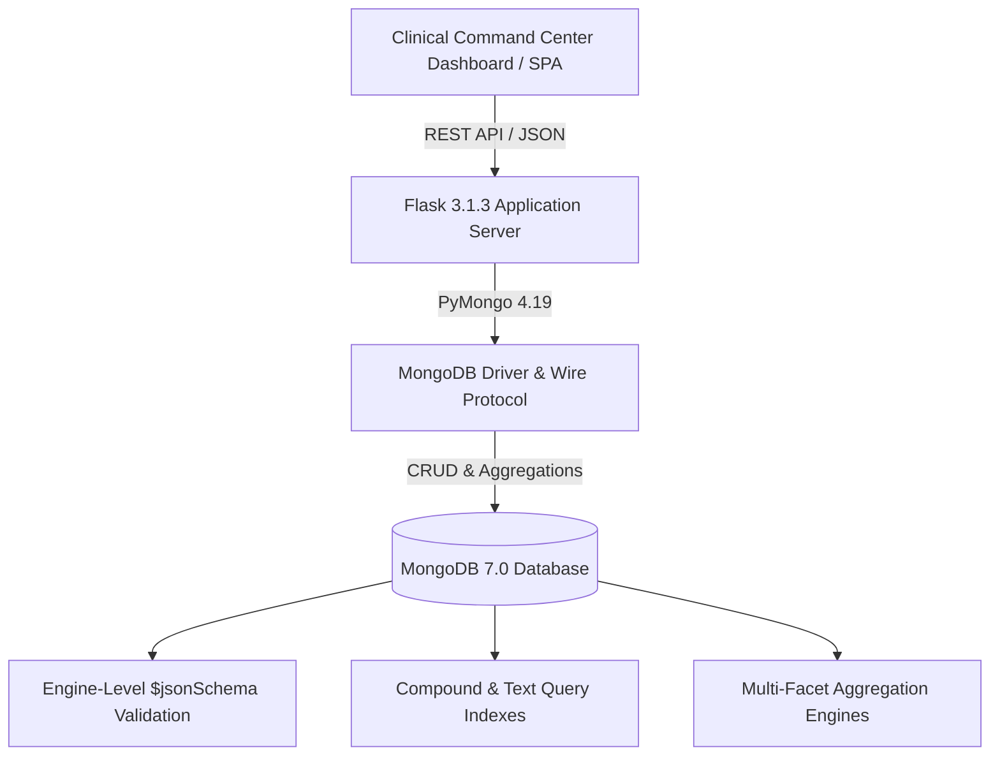

# 🏥 PulseCare AI — Clinical Telemetry & Hospital Command Intelligence Platform

[](https://www.python.org/)
[](https://www.mongodb.com/)
[](https://flask.palletsprojects.com/)
[](https://www.docker.com/)
[](LICENSE)

> **PulseCare AI** is an intelligent emergency healthcare and hospital resource telemetry system engineered with **MongoDB 7.0**, **PyMongo**, and **Flask**. It delivers real-time clinical anomaly detection, atomic bed and ventilator management, engine-level `$jsonSchema` integrity, and multi-stream hospital command analytics (`$facet`).

---

## 🌟 Key Features

- **🚨 Live Clinical Telemetry Feed**: Real-time vital monitoring (Heart Rate, SpO₂, Temperature, Blood Pressure) with automated anomaly alerts for tachycardia, bradycardia, hypoxia, and acute fever.
- **🛡️ Engine-Level Data Integrity (`$jsonSchema`)**: MongoDB-native schema constraints enforcing strict types, regex validation patterns (e.g. `^PAT-[0-9]{4}-[0-9]{4}$`), and clinical enum ranges directly at the storage engine level.
- **⚡ Atomic Resource Allocation**: Concurrency-safe bed and ventilator allocation using atomic PyMongo operators (`$push`, `$inc`, `$set`, `$slice`).
- **📊 5 Advanced Aggregation Pipelines**:
  1. **Emergency Triage Acuity & Length-of-Stay Analysis** (`$group`, `$avg`, `$sort`)
  2. **Ward Capacity & Ventilator Utilization Heatmap** (`$project`, mathematical percentage ratios)
  3. **Telemetry Vitals Anomaly & Critical Risk Detector** (`$unwind`, `$match`, sub-document filtering)
  4. **Physician Caseload & ICU Workload Matrix** (`$lookup`, foreign collection joins)
  5. **360° Hospital Command Multi-Stream Performance** (`$facet` single-pass parallel analytics)
- **🖥️ Clinical Command Center Dashboard**: Sleek dark-mode interface with live operational metrics, bed telemetry visualizer, triage intake form, and live query logs.

---

## 🏗️ Architecture & Technology Stack



- **Backend**: Python 3.11+, Flask 3.1.3, PyMongo 4.19.0, Gunicorn 23.0
- **Database**: MongoDB 7.0 Community / MongoDB Atlas
- **Frontend**: Vanilla JavaScript (ES6+), Modern Semantic HTML5, Glassmorphism CSS Design System
- **DevOps**: Docker, Docker Compose, Gunicorn WSGI, Render / Railway Blueprint

---

## 🚀 Quick Start Guide

### Option 1: Run with Docker Compose (Recommended)

Run both the web app and MongoDB container in one command:

```bash
# Clone the repository
git clone https://github.com/negineeraj331/PulseCare-AI.git
cd PulseCare-AI

# Launch multi-container stack
docker compose up --build
```

Access the dashboard at **[http://localhost:5000](http://localhost:5000)**.

---

### Option 2: Local Python Environment

#### 1. Prerequisites
- Python 3.10+
- MongoDB 7.0 installed and running locally on `localhost:27017`

#### 2. Setup & Run
```bash
# Create virtual environment
python3 -m venv venv
source venv/bin/activate

# Install dependencies
pip install -r requirements.txt

# Start MongoDB daemon and seed test records
./run.sh
```

Or run manually:
```bash
# Seed collections and $jsonSchema rules
python backend/seed_data.py

# Launch application
python backend/app.py
```

The web dashboard is available at **[http://127.0.0.1:5000](http://127.0.0.1:5000)**.

---

## ☁️ Cloud Deployment

### Deploy to Render (Free Tier)
1. Fork or push this repository to GitHub.
2. Sign in to [Render](https://render.com/).
3. Create a **New Web Service** connected to your GitHub repository.
4. Set:
   - **Environment**: Python
   - **Build Command**: `pip install -r requirements.txt`
   - **Start Command**: `gunicorn backend.app:app`
5. Under **Environment Variables**, add:
   - `MONGO_URI`: `mongodb+srv://<username>:<password>@cluster.mongodb.net/pulsecare_hospital_db?retryWrites=true&w=majority`
   - `FLASK_DEBUG`: `0`

*(Or use the provided `render.yaml` for automatic blueprint deployment)*

---

## 📡 REST API Reference

| Method | Endpoint | Description |
| :--- | :--- | :--- |
| `GET` | `/api/health` | Ping database, measure latency, and return collection document counts |
| `GET` | `/api/overview` | Real-time command center summary (admissions, ICU cases, anomalies, bed availability) |
| `GET` | `/api/patients` | List patients with optional filters (`status`, `triage`, `doctor`, `search`) |
| `POST` | `/api/patients` | Register new patient with `$jsonSchema` validation and atomic bed decrement |
| `GET` | `/api/patients/<id>` | Retrieve full patient profile with 24h vital history |
| `POST` | `/api/patients/<id>/vitals` | Push real-time telemetry telemetry record (`$push`, `$slice: -50`) |
| `PATCH` | `/api/patients/<id>/status` | Update patient triage status with atomic ward occupancy adjustment |
| `DELETE` | `/api/patients/<id>` | Discharge patient and atomically restore bed capacity |
| `GET` | `/api/analytics/triage` | Emergency triage breakdown and average length-of-stay pipeline |
| `GET` | `/api/analytics/ward-occupancy` | Real-time ward occupancy and ventilator capacity analytics |
| `GET` | `/api/analytics/anomalies` | Live telemetry anomalies detected across all admitted patients |
| `GET` | `/api/analytics/doctor-workload` | Physician caseload and active ICU patient distribution |
| `GET` | `/api/analytics/command-360` | Full single-pass multi-stream hospital facet analytics (`$facet`) |

---

## 🧪 Terminal Viva & Defense Tool

Run the interactive terminal demonstration script:
```bash
python terminal_viva_demo.py
```
This script demonstrates:
1. Engine-level `$jsonSchema` write rejection tests (verifying MongoDB Error Code 121).
2. Atomic CRUD operations with rollback safety.
3. Live execution and explanation of all 5 MongoDB aggregation pipelines.

---

## 📄 License
This project is open-source under the [MIT License](LICENSE).
